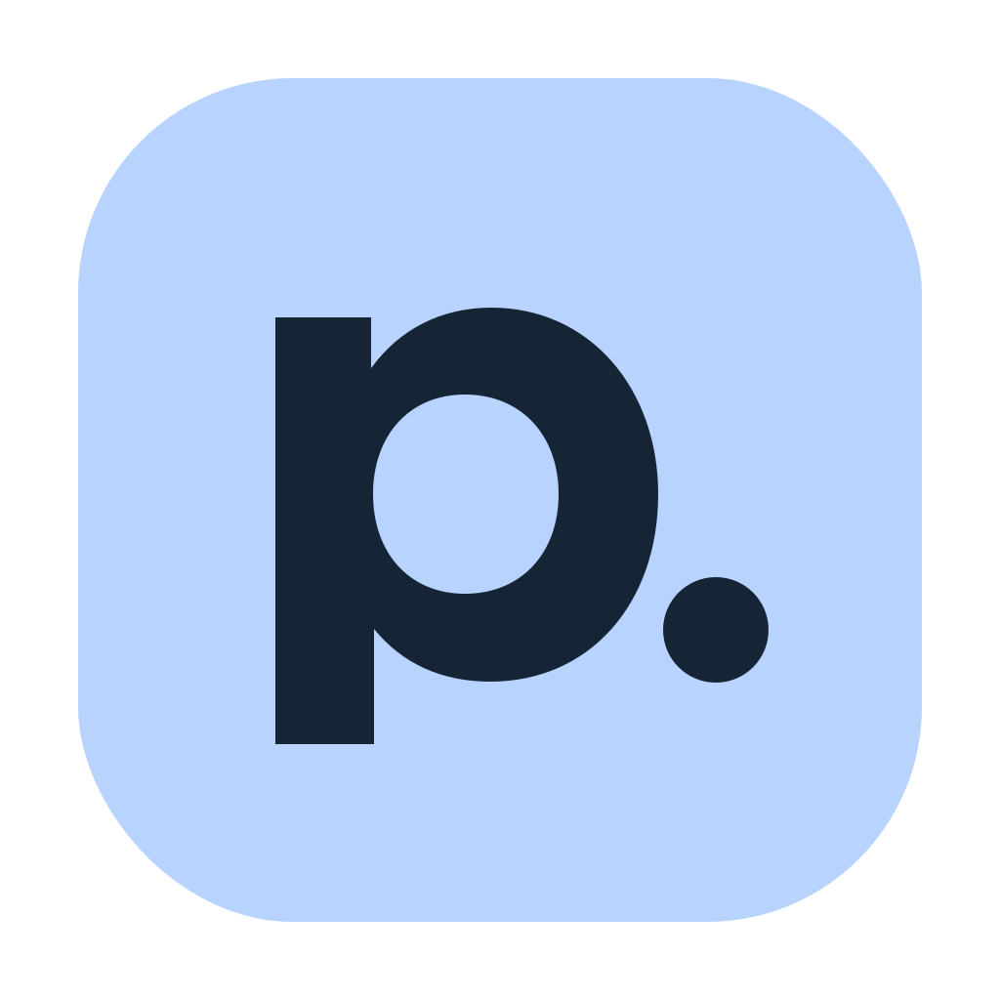
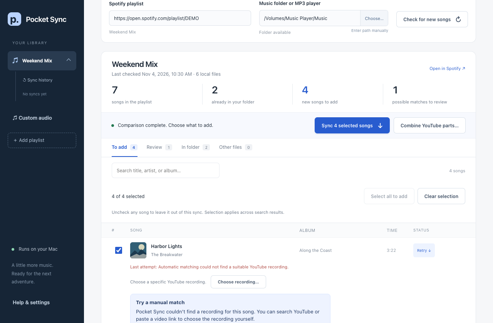

# Pocket Sync



Pocket Sync is a macOS app for syncing public Spotify playlists with a music folder or a USB MP3 player. Compare the tracks first, review uncertain matches, then add only what’s missing. It can reuse audio you already have and look for missing recordings on YouTube.

[**Try the source preview**](#install-from-source) · [View screenshots](docs/SCREENSHOTS.md) · [See a USB MP3 player sync](docs/USB-MP3-PLAYER.md)

The app runs locally on your Mac. Setup requires no account or API key. Pocket Sync is independent of Spotify and YouTube. Use only sources you are authorized to download under the applicable service terms and law.



*Example playlist using fictional tracks and artwork.*

## What you can do

- **Compare before syncing.** See what is already in the folder, what needs a closer look, and what is missing.
- **Choose the recording.** Compare YouTube results by artist, version, and duration. The app can guide you through the picker after a failed match.
- **Combine parts.** Join a YouTube playlist into one MP3 when it contains the same recording split differently on Spotify.
- **Import custom audio.** Preview a YouTube video or playlist and choose where to save it.
- **Keep a record.** Save multiple playlist destinations and review what each sync copied or failed to add.

[Browse the screenshots](docs/SCREENSHOTS.md) · [Read the user guide](POCKET-SYNC.md) · [Report a problem or request a feature](https://github.com/csabarakasz/pocket-sync/issues/new/choose)

## Availability

The initial public release contains the source and setup instructions. The build targets Apple silicon Macs. The bundled Mac ZIP is a separate distribution step. See the [release checklist](RELEASING.md).

## Install from source

Download the source ZIP from **Code → Download ZIP** or clone the repository. Install [Homebrew](https://brew.sh/) if needed. In Terminal, run:

```sh
brew install python@3.14 ffmpeg deno
xcode-select --install
```

Wait for the Apple developer tools installation to finish. Open Terminal in the project folder and run:

```sh
/bin/zsh scripts/setup_macos.sh
```

Setup installs the Python packages and builds `.runtime/Pocket Sync.app`. Open it from Finder or copy it to your Desktop. If you move the source folder, rerun setup and replace the old app. For browser access, run `.venv/bin/python -m playlist_sync.server` and keep Terminal open.

## First playlist

On your first launch, the app offers a walkthrough with sample match results, a recording search, and a Custom audio import preview. Select **Help & settings → Replay walkthrough** in the sidebar. The first time a song has no automatic YouTube match, Pocket Sync offers **Show me how** beside **Dismiss tip**. The walkthrough highlights **Choose recording…**, the search and link options, and the download button after you choose a recording.

1. Create an empty, writable folder for a trial run.
2. Open **Library settings**, name the library, paste a full public Spotify playlist link, and select your trial folder. **Enter path manually** lets you paste the folder path without the macOS chooser. Save the library.
3. Click **Check for new songs**. Pocket Sync shows the current stage and a count when Spotify reports the playlist size. You can stop the check from the progress area. In **To add**, try one track first and listen to the MP3 before syncing a larger selection. Automatic matches can select a different recording or edit.

For YouTube-only imports, choose **Custom audio → Add from YouTube…**, paste a link, and select a destination. A connected MP3 player can be a destination if macOS mounts it as a normal drive. See the [user guide](POCKET-SYNC.md) for matching, bulk sync, and history.

## What’s new in 1.1.0

- Faster repeat checks with persistent file metadata caching and reuse of Spotify track details. Playlist membership is still checked fresh.
- Review failed recording matches in one queue, save choices, then download the matched batch.
- Play YouTube search-result previews inside the app before selecting a recording.
- A consistent 20-second duration tolerance with warnings for longer differences.
- **Simple filenames remain the default:** `Artist - Title.mp3`. Optional destination-specific numbering lives under **Help & settings → Song filenames**, with 1–6 digits of padding and a filename preview before applying.

## Other launch options

- **Finder shortcut.** After setup, double-click `Open Pocket Sync.command`. If Finder cannot launch it after extracting a ZIP, use the Terminal command above or run `/bin/zsh "Open Pocket Sync.command"` from the project folder.
- **Original downloader.** Open `Download Music.command` or run `.venv/bin/python download.py 'https://open.spotify.com/track/TRACK_ID'`. Substitute a real track ID, or use a full album or public playlist link. Add `--output '/path/to/music'` to change the base destination. Each run puts MP3s, logs, and a verification report in a dated folder. Recheck a previous run with `.venv/bin/python download.py --verify 'Downloads/PREVIOUS_DOWNLOAD_FOLDER'`.
- **Optional spotDL web UI.** Open `Open spotDL.command` and visit [http://127.0.0.1:8801](http://127.0.0.1:8801). This launcher applies the local URL-redirect workaround to spotDL 4.6.0 inside the project environment and saves downloads under `Downloads/`. See the [upstream spotDL project](https://github.com/spotDL/spotify-downloader/tree/v4.6.0).

## Troubleshooting

- **Setup cannot find Python or FFmpeg.** Run the Homebrew install command above. If you moved the project and its virtual environment stopped working, move the old `.venv` out of the folder and rerun setup.
- **The folder chooser fails.** Use **Enter path manually**, or install the Apple developer tools with `xcode-select --install` and try again.
- **The source server port is in use.** Run `.venv/bin/python -m playlist_sync.server --port 8890` and use the address printed in Terminal. Stop the previous server for this checkout before starting another on a different port.
- **Spotify or YouTube refuses a request.** Check that the link is public, verify `deno --version`, and read the download details in the app. Both services can change their public access or rate limits, which may require dependency updates.
- **The app reports a missing file or incorrect recording.** Review the saved log and try **Choose recording…**. Verified files use 128 kbps MP3 with embedded artwork and tags.

## Tests and local files

```sh
.venv/bin/python -m unittest discover -s tests -v
```

The suite uses FFmpeg to generate test audio. The JavaScript selection test runs when Node.js is available. Network service responses are mocked in the suite.

The downloaded app keeps its settings, sync history, reports, and startup log in `~/Library/Application Support/Pocket Sync/`. The source checkout keeps its own data under `.runtime/`. The command-line downloader uses `Downloads/` by default. spotDL can also keep configuration and cache files in your user folder. Git ignores the project environment, runtime files, downloads, and generated app bundles. `requirements.txt` is the install list. `requirements-lock.txt` records the versions used to build the release.


## Privacy and contributions

See [what Pocket Sync stores and sends](docs/PRIVACY.md) and [how to report or reproduce an issue](CONTRIBUTING.md). The project currently has no general reuse license. Third-party components retain their own licenses.
