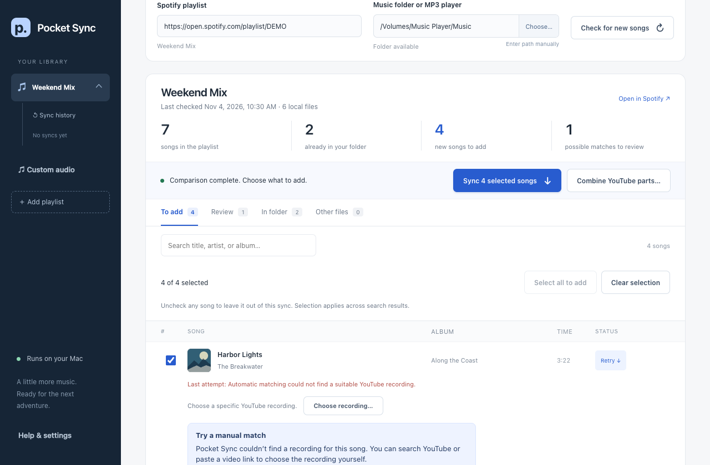
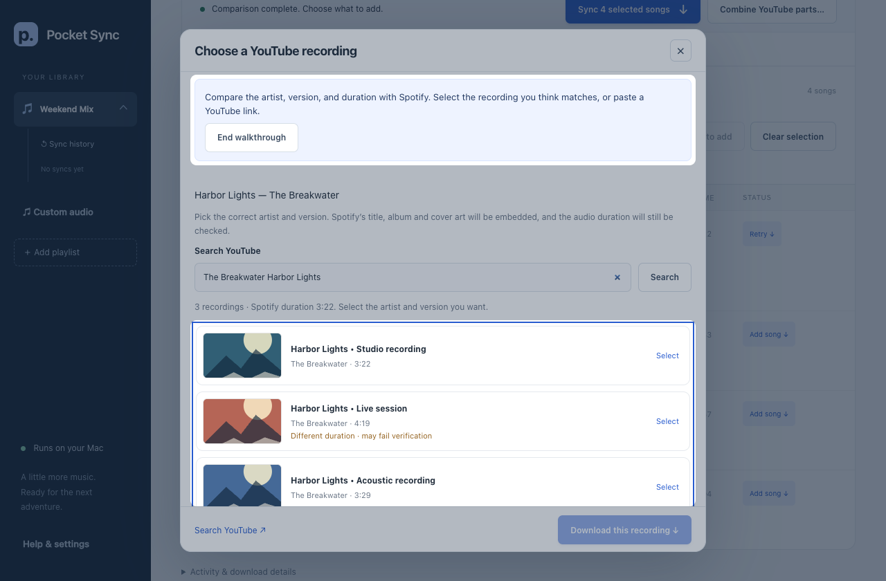
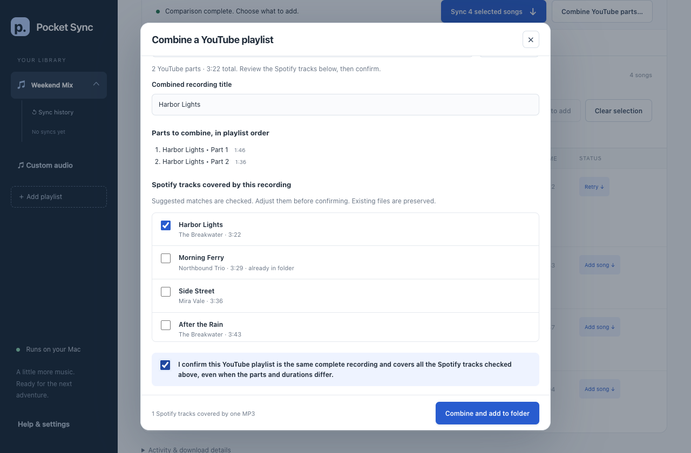
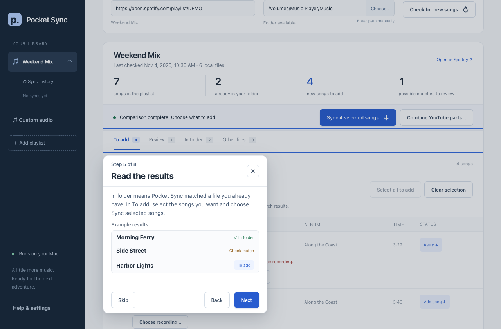

# A look inside Pocket Sync

All screenshots use fictional playlists, tracks, artwork, and recording results. They were captured from the app with simulated service responses.

## Compare a playlist

## Choose a recording

## Combine YouTube parts

## Replay the walkthrough

