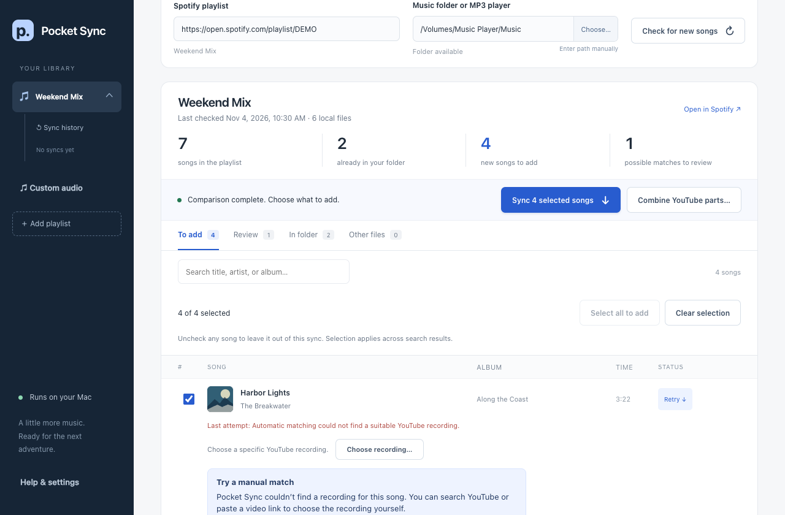
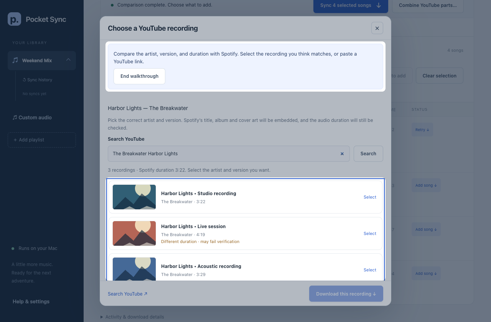

# Sync a Spotify playlist to a USB MP3 player on macOS

Use Pocket Sync to check what’s already on a player and add only the tracks you select. This example uses the fictional **Weekend Mix** playlist.

1. Connect your MP3 player and check that it appears as a drive in Finder. Open Pocket Sync and paste the public Spotify playlist link.
2. Choose the player's music folder as the destination. Click **Check for new songs**. Spotify provides the playlist and track metadata.
3. Read the comparison. **In folder** shows recognized files, **Review** shows uncertain matches, and **To add** shows tracks the app can add. The example shows two already present, one to review, and four to add.

4. In **To add**, select a track and sync it. Pocket Sync can copy a matching file you already have or look for a matching YouTube recording. If it needs your help, use **Choose recording…** and compare the artist, version, and duration. Use audio you’re authorized to download.

5. Open **Sync history** to see which files were added and which need attention. Eject the player in Finder when the sync is complete.

[Install Pocket Sync from source](../README.md#install-from-source) · [Read the full user guide](../POCKET-SYNC.md)
